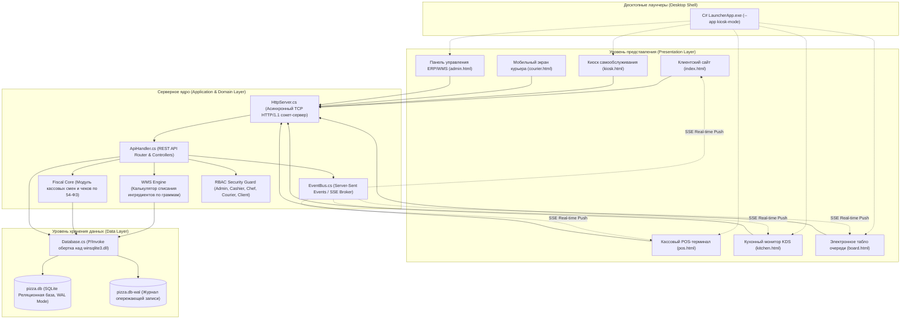
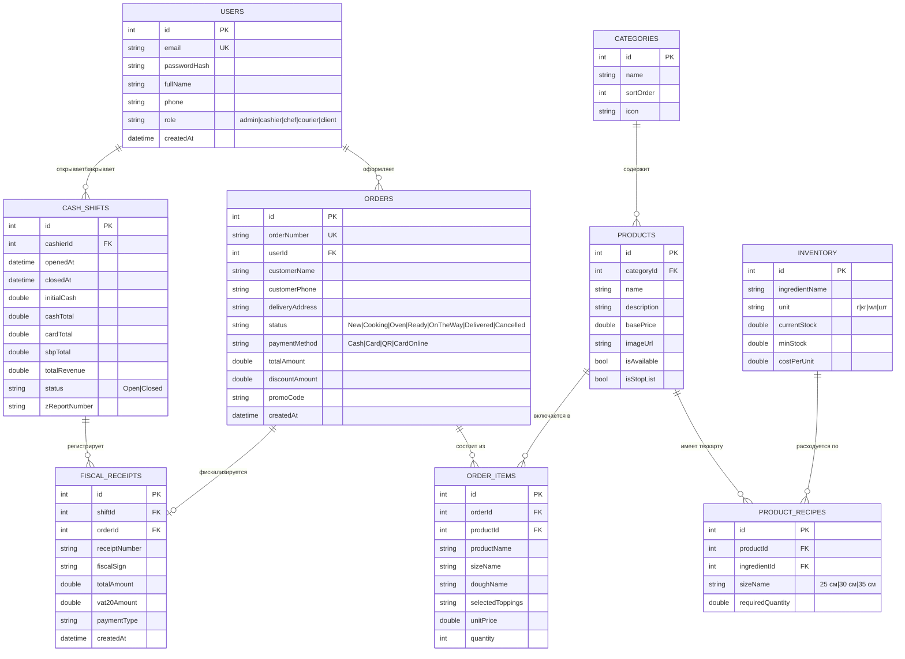
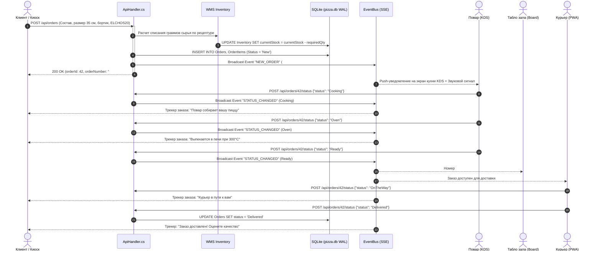

# 📐 Архитектурный план реализации (implementation_plan.md) — Elcho's Pizza

Стандарт: **Google DeepMind Agentic Blueprint (master_project_blueprint.html)**  
Система: **Комплексная автоматизация ресторанного бизнеса и сервиса экспресс-доставки Elcho's Pizza**

---

## 1. Концептуальная архитектура и стратификация слоев

Система построена по принципу **Clean Three-Tier Architecture** с реактивной событийно-ориентированной шиной реального времени:

---

## 2. Схема базы данных (Entity-Relationship Diagram)

Схема нормализована до 3NF и полностью отражает бизнес-логику пиццерии, складского учета (WMS) и фискальной кассовой дисциплины (54-ФЗ):

---

## 3. Сквозной поток данных (Data Flow Lifecycle)

---

## 4. Карта модулей системы

### Серверная часть (`project/src/`):
1. **`HttpServer.cs`**: Многопоточный сокетный HTTP/1.1 сервер, обработчик MIME-типов, парсер потоков и заголовков безопасности.
2. **`ApiHandler.cs`**: Контроллеры аутентификации, каталога меню, заказов, WMS-склада, кассовых смен 54-ФЗ, отзывов и аналитики.
3. **`EventBus.cs`**: Брокер Server-Sent Events (SSE) с потокобезопасной коллекцией подписчиков.
4. **`Database.cs`**: Низкоуровневый C# клиент к `winsqlite3.dll` с подготовленными выражениями (`sqlite3_bind_*`).
5. **`DbInitializer.cs`**: Инициализатор базы данных, структуры таблиц и начальных фикстур (44 товара, рецептуры, пользователи).
6. **`TestSuite.cs`**: Комплекс из 40 сквозных интеграционных тестов (`Тест_Системы.exe`).
7. **`LauncherApp.cs`**: Загрузчик рабочих мест Windows в Kiosk-режиме (`--app`).

### Клиентская часть (`project/wwwroot/`):
1. **`index.html`** + **`app.js`**: Витрина онлайн-заказа, конструктор пиццы, корзина, промокоды и онлайн-трекер.
2. **`pos.html`**: Сенсорный кассовый терминал, смены по 54-ФЗ, печать чеков.
3. **`kitchen.html`**: Экран повара KDS со стадиями и интерактивными техкартами.
4. **`board.html`**: Табло очереди зала с акустическим гонгом Web Audio.
5. **`kiosk.html`**: Киоск самообслуживания гостей торгового зала.
6. **`courier.html`**: Мобильный экран службы доставки.
7. **`admin.html`**: Панель управления, склад WMS, стоп-листы, аналитика выручки и журнал аудита.
8. **`css/styles.css`**: Единая дизайн-система, цветовая палитра HSL, адаптивность и скелетоны загрузки.
